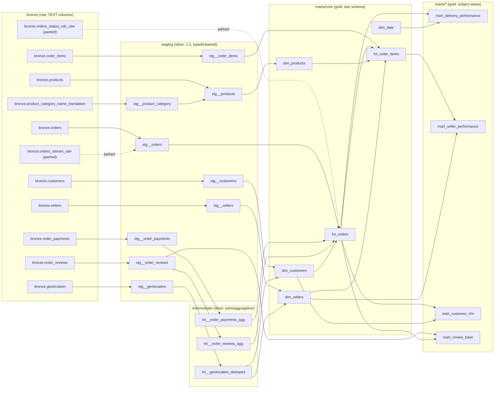

# Model lineage

The full model DAG for this dbt project, bronze through gold. See the
[project README](README.md) for layer conventions, grain gotchas, and testing.

Streaming and CDC ingestion (shown here as **parked**) are not built — the
source dataset is static, so there's no live system to stream or capture
changes from. The schema design for them is kept as a reference for later.

## Diagram

## Staging (`models/staging/`)

One model per bronze table, 1:1, no business joins (casts/renames/cleans only).

| Model | Source | Grain | Notes |
|---|---|---|---|
| `stg__customers` | `bronze.customers` | 1 row / `customer_id` | zip prefix cast to int |
| `stg__geolocation` | `bronze.geolocation` | raw, not yet deduped | dedup happens in `int__geolocation_deduped` |
| `stg__orders` | `bronze.orders` | 1 row / `order_id` | all 5 timestamp columns cast |
| `stg__order_items` | `bronze.order_items` | 1 row / (`order_id`, `order_item_id`) | price/freight cast to numeric |
| `stg__order_payments` | `bronze.order_payments` | 1 row / (`order_id`, `payment_sequential`) | multiple rows per order — installments |
| `stg__order_reviews` | `bronze.order_reviews` | 1 row / (`review_id`, `order_id`) | a review can attach to more than one order |
| `stg__product_category` | `bronze.product_category_name_translation` | 1 row / `product_category_name` | small lookup table |
| `stg__products` | `bronze.products` + `stg__product_category` | 1 row / `product_id` | **documented exception**: joins the category translation here, so every downstream model works in English |
| `stg__sellers` | `bronze.sellers` | 1 row / `seller_id` | zip prefix cast to int |

## Intermediate (`models/intermediate/`)

Only exists where staging-grain data needs reshaping before it can join cleanly
into a fact/dim at the right grain.

| Model | Built from | Purpose |
|---|---|---|
| `int__geolocation_deduped` | `stg__geolocation` | collapse many-to-many zip-prefix rows to one row per prefix, dropping points outside Brazil's bounding box |
| `int__order_payments_agg` | `stg__order_payments` | one row per `order_id` (total paid, payment method count, installment max) |
| `int__order_reviews_agg` | `stg__order_reviews` | one row per `order_id` (latest review by answer timestamp), for `fct_orders` — `mart_review_base` keeps every review unaggregated |

## Core marts (`models/marts/core/`) — the star schema

| Model | Built from | Grain |
|---|---|---|
| `dim_customers` | `stg__customers` + `int__geolocation_deduped` | 1 row / `customer_unique_id` (not `customer_id` — see the README's grain gotchas) |
| `dim_sellers` | `stg__sellers` + `int__geolocation_deduped` | 1 row / `seller_id` |
| `dim_products` | `stg__products` | 1 row / `product_id` |
| `dim_date` | generated (`generate_series`) | 1 row / calendar date, 2016-01-01 to 2018-12-31 |
| `fct_orders` | `stg__orders` + `int__order_payments_agg` + `int__order_reviews_agg` + `dim_customers` | 1 row / `order_id` |
| `fct_order_items` | `stg__order_items` + `fct_orders` + `dim_products` + `dim_sellers` | 1 row / (`order_id`, `order_item_id`) |

## Subject marts (`models/marts/<subject>/`)

| Model | Built from | Answers |
|---|---|---|
| `mart_delivery_performance` | `fct_orders` + `dim_date` | actual vs. estimated delivery, late-delivery rate by state/period |
| `mart_seller_performance` | `fct_order_items` + `dim_sellers` | revenue, order count, avg delivery time per seller |
| `mart_customer_rfm` | `fct_orders` + `dim_customers` | recency/frequency/monetary segmentation per `customer_unique_id` |
| `mart_review_base` | `stg__order_reviews` + `fct_orders` | one row per review with order context — this is the table the review-embedding pipeline reads from |
